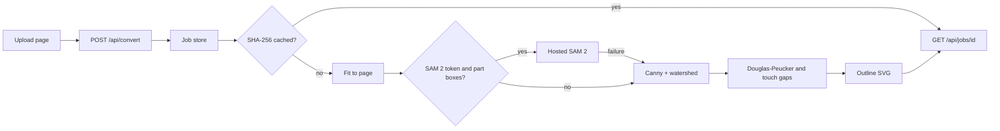

# TouchSight

TouchSight turns a textbook diagram, chart, map, or photo into a graphic a blind or low-vision student can read by touch. This build is the first slice: upload an image, watch the job move through the pipeline, and download a tactile outline SVG sized for swell paper or an embosser.

## What works now

1. The image is scaled to fit a Letter or A4 sheet.
2. Regions are found with OpenCV (Canny edges, then watershed). A hosted SAM 2 client is wired in and used only when an API token and part boxes are both present; any failure falls back to OpenCV.
3. Contours are smoothed, thin gaps are opened so a finger can tell lines apart, and the result is an SVG.
4. `POST /api/convert` returns a job id. `GET /api/jobs/{id}` reports every stage. The same image bytes are served from a hash cache, including four precomputed sample images.

Texture fills, Braille, the relief STL, and the explore-by-touch screen are the next stages. They are named in the job record and skipped for now.

## Architecture



| Path | Role |
| --- | --- |
| `backend/pipeline/` | One module per stage. `segment.py` and `simplify.py` run today. |
| `backend/app/` | FastAPI, job store, hash cache. |
| `backend/demo_cache/` | Four hero images and their finished SVGs. |
| `frontend/` | Upload page that polls the job and shows the sheet. |
| `docs/PIPELINE.md` | Why each stage is built the way it is. |

## Run it

Docker, from this folder:

```bash
docker compose up --build
```

Open http://localhost:5173. The API is http://localhost:8000. Defaults are enough; copy `.env.example` to `.env` only if you want a SAM token or different millimetre thresholds.

Without Docker, two terminals:

```bash
cd backend
python -m venv .venv
.venv\Scripts\python -m pip install -r requirements.txt
.venv\Scripts\uvicorn app.main:app --reload --port 8000
```

```bash
cd frontend
npm install
npm run dev
```

On macOS or Linux, use `.venv/bin/python` and `.venv/bin/uvicorn` instead.

Rebuild the sample cache after a pipeline change:

```bash
cd backend
.venv\Scripts\python scripts\build_demo_cache.py
```

## Tests

```bash
cd backend
.venv\Scripts\python -m pytest
```

## API

- `POST /api/convert` with multipart field `file`. Response: `{ "job_id": "..." }`.
- `GET /api/jobs/{id}` — status, per-stage progress, artifact URLs.
- `GET /api/artifacts/{id}/outline.svg` — the sheet.
- `GET /api/samples` — the built-in diagrams (heart, animal cell, bar chart, and world map first).
- `GET /api/artifacts/{id}/region_map.json` — region ids, names, and polygons.
