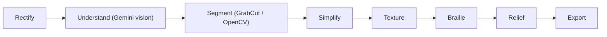

# TouchSight

Turn any textbook diagram into something a blind student can feel and hear, in seconds instead of hours.

<!-- DEMO GIF HERE -->

[](https://github.com/DhruvalAnandkar/touchsight/actions/workflows/ci.yml)
[](LICENSE)
[](https://www.python.org/downloads/release/python-3110/)
[](https://react.dev/)
[](https://fastapi.tiangolo.com/)
[](https://threejs.org/)
[](https://github.com/DhruvalAnandkar/touchsight)
[](https://github.com/DhruvalAnandkar/touchsight)

## The problem

A tactile graphic of one textbook diagram can take a specialist hours to trace, texture, and Braille. Students who cannot see the picture wait, or they get a description with nothing to feel. TouchSight does that conversion from a photo or a file.

## What it does

- **Tactile sheet.** Outlines, distinct textures for neighboring regions, and Grade 1 Braille for the title and legend. Download SVG for an embosser or swell paper, or PDF to print.
- **3D relief.** A watertight STL a student can hold, with regions and borders raised off a flat base.
- **Explore by touch and voice.** Move across the sheet, hear the region under your finger, and step through parts by importance.

## How it works



A phone photo of a page is straightened first. Gemini names the parts. Segmentation follows those boxes, with OpenCV as the fallback. The rest of the pipeline fits the shapes to a page, fills them so neighbors do not share a texture, writes Braille, builds the relief, and exports the sheet.

## Who it's for

Blind and low-vision students get paper they can feel or a 3D print they can hold. Teachers and schools can start from a phone photo of a worksheet. There is no account and no password.

## Tech stack

Python 3.11, FastAPI, OpenCV, Shapely, React 19, Vite, Tailwind, and three.js. Vision labels use Gemini through an OpenAI-compatible endpoint when a key is set. Samples still run with no key.

## Run it locally

From the repository root, in two terminals:

```powershell
cd backend; python -m venv .venv; .\.venv\Scripts\python -m pip install -r requirements.txt
.\.venv\Scripts\uvicorn app.main:app --reload --port 8000
```

```powershell
cd frontend; npm install; npm run dev
```

Open http://localhost:5173. The page proxies API calls to http://127.0.0.1:8000. On macOS or Linux, use `.venv/bin/python` and `.venv/bin/uvicorn`.

## Environment variables

Copy `backend/.env.example` to `backend/.env`. Leave the keys empty to run on the built-in samples. Do not commit `.env`.

| Variable | Purpose |
| --- | --- |
| `PAGE_SIZE` | `letter` or A4 |
| `DPI` | Raster scale before segmentation |
| `MARGIN_MM` | Page margin |
| `MIN_STROKE_MM` | Thinnest line a finger should feel |
| `MIN_GAP_MM` | Smallest gap between lines |
| `MIN_AREA_MM2` | Smallest filled region |
| `EPSILON_MM` | Polygon simplification tolerance |
| `MAX_REGIONS` | Cap on named regions |
| `SAM_API_TOKEN` | Optional hosted SAM 2 token. Empty uses OpenCV |
| `SAM_MODEL` | Replicate model id |
| `SAM_API_BASE` | SAM API origin |
| `SAM_TIMEOUT_S` | SAM call timeout |
| `VLM_PROVIDER` | `openai` for the Gemini-compatible endpoint. Empty skips the model |
| `VLM_MODEL` | Comma-separated model list. A 429 or quota error tries the next model immediately |
| `VLM_BASE_URL` | OpenAI-compatible base URL |
| `VLM_API_KEY` | Vision API key. Empty in tests |
| `ANTHROPIC_API_KEY` | Alternate key, unused when `VLM_API_KEY` is set |
| `OPENAI_API_KEY` | Alternate key, unused when `VLM_API_KEY` is set |
| `OPENAI_BASE_URL` | Fallback base URL |
| `DEPTH_API_TOKEN` | Reserved for a depth model |
| `RELIEF_MAX_MM` | Longest side of the STL, in millimetres |

## Accessibility notes

The sheet is the accessible object: raised lines, textures that change where regions touch, and Braille inside the page margins. The web app uses buttons with visible names, keeps contrast high, and does not require a pointer for the main flow. A screen reader can move by headings and buttons. Voice output, when present, can be left off so it does not talk over a screen reader.

## Sample credits

Every built-in diagram is an original CC0 drawing. See [backend/samples/CREDITS.md](backend/samples/CREDITS.md).

## License

MIT. Copyright 2026 Dhruval Anandkar. See [LICENSE](LICENSE).
